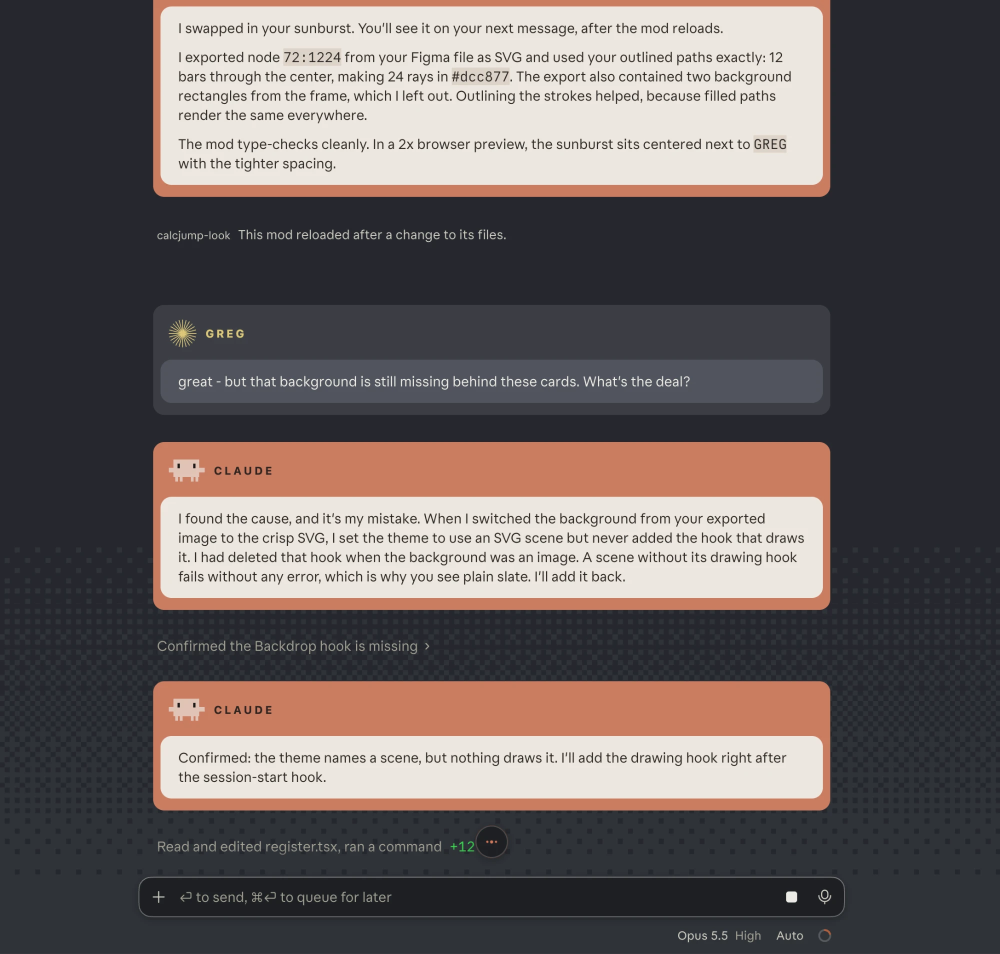

# Claude Retro Theme

A retro, pixel-art look for Claude Desktop, inspired by the CalcJump calculator app.



- **Claude's replies** sit on terracotta cards with a cream body and a little pixel mascot.
- **Your messages** sit on slate cards with a gold sunburst and your name.
- **The background** is slate, with a square-pixel dither rising from the bottom of the window.
- **Colors** across the app follow the same slate, cream and terracotta palette.

It's a Claude Code mod: a small plugin that changes how the app looks. It only changes how things are drawn. It doesn't read your files, send anything anywhere, or change what Claude does.

## Install

At the prompt of a terminal Claude Code session:

```
/plugin install calcjump-retro-theme --marketplace greg-althoff/claude-retro-theme
```

Answer `y` to add the marketplace, then pick a scope (user scope applies it to every session).

From a shell:

```bash
claude plugin install calcjump-retro-theme --marketplace greg-althoff/claude-retro-theme
```

In the Claude desktop app, where `/plugin` doesn't run: click **+** next to the prompt box, then **Plugins**, **Add marketplace** with `greg-althoff/claude-retro-theme`, then **Add plugin**.

## Your name

The install asks for **Your name**, which shows in capitals on your message cards. Leave it empty and your cards say `YOU`. You can change it later in `/config`.

## Notes

- The cards draw in Claude Desktop. The terminal keeps its normal look.
- The theme is dark only.
- Messages you send with an image show the image inside your card.

Designed by [greg-althoff](https://github.com/greg-althoff).
